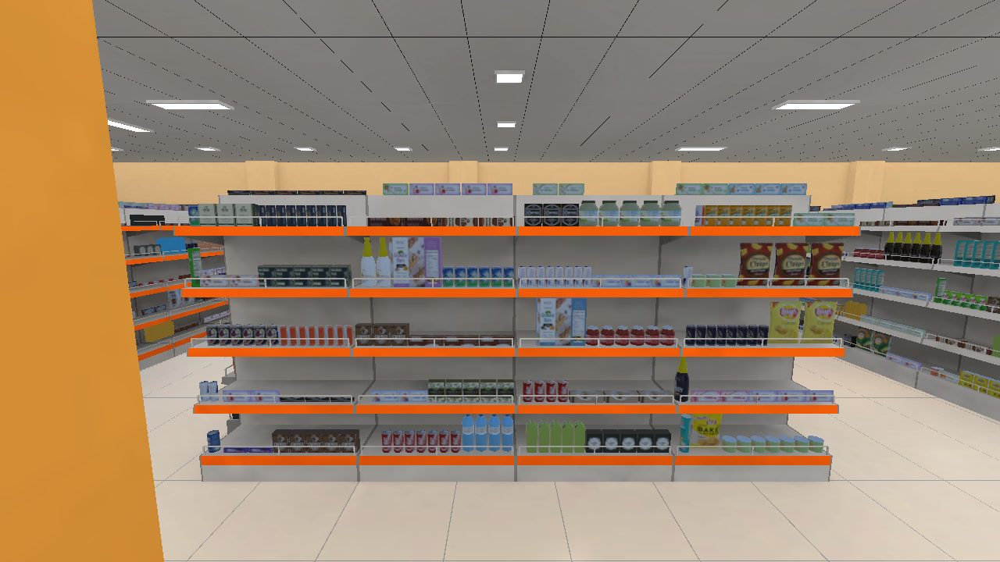
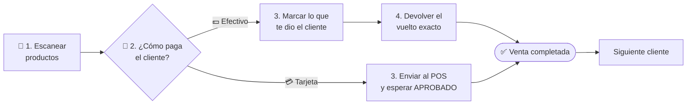
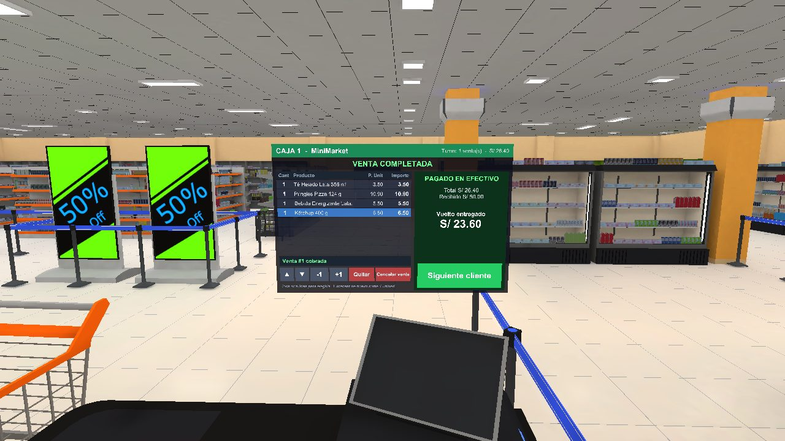
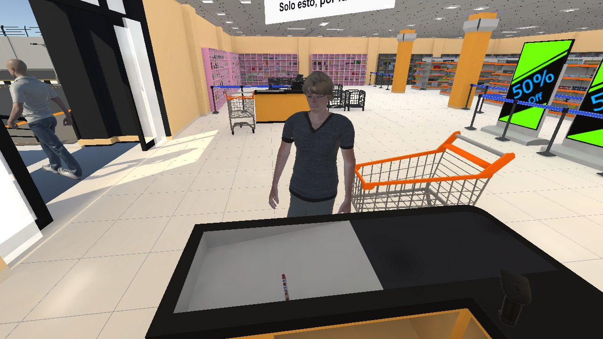
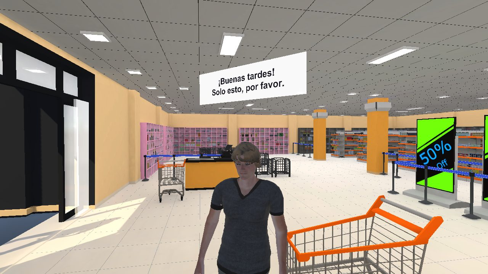
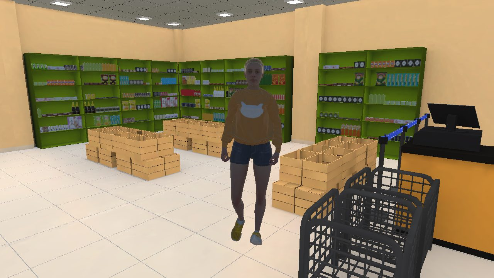

<div align="center">



<br>

# 🛒 Cajero XR

### Aprende a ser cajero de un minimarket… en realidad virtual.

Escanea productos, cobra en efectivo o con tarjeta, devuelve el vuelto exacto<br>
y atiende a clientes que hacen fila, pagan y se quejan si te equivocas.

<br>


<br>

[**Qué es**](#-qué-es) &nbsp;·&nbsp;
[**Cómo se cobra**](#-cómo-se-cobra) &nbsp;·&nbsp;
[**Capturas**](#-capturas) &nbsp;·&nbsp;
[**Controles**](#-controles) &nbsp;·&nbsp;
[**Instalación**](#-instalación) &nbsp;·&nbsp;
[**Herramientas**](#-herramientas-del-editor) &nbsp;·&nbsp;
[**Roadmap**](#-roadmap)

</div>

<br>

## ✨ Qué es

**Cajero XR** es un simulador en realidad virtual hecho en **Unity 6** para **practicar el trabajo de cajero** sin presión: escaneas, cobras y das vuelto como en una tienda de verdad, con clientes que llegan solos y te dicen cuando algo salió mal. También se puede jugar solo por diversión.

<table>
<tr>
<td width="33%" valign="top">

### 🏪 Tienda llena
Más de **6 000 productos** con su **tamaño real**, refrigeradoras y cubículos incluidos, todos se pueden agarrar y escanear. Se dibujan por bloques para que el Quest aguante.

</td>
<td width="33%" valign="top">

### 🧾 Caja con pasos
Escaneo con pistola, **efectivo o tarjeta (POS)**, billetes y monedas de **Perú** y **vuelto verificado** por la caja.

</td>
<td width="33%" valign="top">

### 🧑‍🤝‍🧑 Clientes reales
Entran, eligen productos, **hacen fila**, te dicen cómo pagan y **reclaman** si les cobras de más o te equivocas.

</td>
</tr>
<tr>
<td valign="top">

### 💲 Base de datos
**90 productos** con código de barras, categoría, **precio en soles** y stock, en un JSON fácil de editar.

</td>
<td valign="top">

### 🤲 Manos y mandos
Agarra con los **controladores** o con tus **manos** (XR Hands). Camina con joystick o **moviendo los brazos**.

</td>
<td valign="top">

### 🌙 Día y noche
La tienda pasa del día a la noche; la **venta en curso y el turno se conservan** al cambiar.

</td>
</tr>
<tr>
<td valign="top">

### 💵 Dinero, POS y boleta en 3D
El cliente deja sus **billetes y monedas** en la bandeja, acerca su **tarjeta al POS** y al final sale una **boleta impresa** que se puede agarrar.

</td>
<td valign="top">

### 🗣️ Clientes que hablan
Saludan, dicen cómo pagan y reclaman **con voz** (sonido 3D). Y tú les puedes **hablar**: *"¿cómo va a pagar?"*, *"¿algo más?"*, *"gracias"*.

</td>
<td valign="top">

### 🛒 Carritos
Los clientes toman un **carrito**, lo empujan por los pasillos con sus productos dentro y en la caja los **sacan uno por uno**.

</td>
</tr>
<tr>
<td valign="top">

### 📊 Evaluación del turno
Resumen con ventas, tiempo promedio, errores de vuelto, quejas y clientes perdidos, con una **nota de 0 a 20**.

</td>
<td valign="top">

### 📳 Vibración y sonidos
El mando **vibra** al escanear y agarrar. Suenan las **monedas**, el **cajón**, la **impresora** y los productos al caer.

</td>
<td valign="top">

### 🏷️ Letrero Cajero XR
La fachada y el **menú principal** tienen ahora la misma identidad que la tienda: naranja, blanco y gris.

</td>
</tr>
</table>


<br>

## 🧾 Cómo se cobra

Arriba de la pantalla de la caja siempre dice **en qué paso estás**. El orden es este:



| Paso | Qué haces | Botones |
|:---:|---|---|
| **1** | Acerca la pistola a cada producto y aprieta el **gatillo**. Cada bip suma 1 unidad. | **−1 · +1 · Quitar · Cancelar venta** para corregir. Luego **COBRAR ›** |
| **2** | Mira la burbuja del cliente: *"Con tarjeta, por favor"* o *"En efectivo. Aquí tienes S/ 50"*. | **EFECTIVO** o **TARJETA** |
| **3** 💵 | Marca los billetes y monedas que te dio. | **S/ 200 … S/ 0.10 · Exacto · Borrar** → **CONFIRMAR ›** |
| **4** 💵 | Marca el vuelto que le devuelves. La caja revisa que sea **exacto**. | Billetes y monedas · **Ayuda** · **Borrar** → **ENTREGAR VUELTO** |
| **3** 💳 | El cliente acerca la tarjeta: *Procesando… → APROBADO*. | **ENVIAR AL POS** |
| ✅ | El cliente se despide (o reclama si algo salió mal). | **Siguiente cliente** |

> [!NOTE]
> Mientras cobras, en el mostrador pasa lo mismo en 3D: el cliente deja su dinero en la **bandeja**, el vuelto que marcas aparece al otro lado y, al terminar, la **impresora** saca la boleta de práctica. Con el botón **Resumen del turno** ves tu nota.

> [!TIP]
> Si no sabes cómo armar el vuelto, el botón **Ayuda** te sugiere qué billetes y monedas dar.<br>
> Ejemplo: vuelto de **S/ 23.60** → 1 × S/ 20 · 1 × S/ 2 · 1 × S/ 1 · 1 × S/ 0.50 · 1 × S/ 0.10.


<br>

## 📸 Capturas

<table>
<tr>
<td width="50%"></td>
<td width="50%"></td>
</tr>
<tr>
<td align="center"><sub><b>Pantalla de la caja</b> · venta completada y vuelto entregado</sub></td>
<td align="center"><sub><b>Vista del cajero</b> · el cliente deja sus productos en la banda</sub></td>
</tr>
<tr>
<td width="50%"></td>
<td width="50%"></td>
</tr>
<tr>
<td align="center"><sub><b>Clientes que hablan</b> · saludan, dicen cómo pagan y reclaman</sub></td>
<td align="center"><sub><b>Pasillos llenos</b> · productos de tamaño real</sub></td>
</tr>
</table>


<br>

## 🎮 Controles

| Acción | 🎮 Controladores | 🤲 Manos |
|---|---|---|
| **Agarrar** | Tocar el objeto y apretar **Grip** | Tocar el objeto y cerrar la mano |
| **Escanear** | Con la pistola en la mano, apretar el **gatillo** | Pellizcar con la pistola en la mano |
| **Pulsar la pantalla** | Apuntar con el rayo y apretar el **gatillo** | Apuntar y pellizcar |
| **Caminar** | Joystick izquierdo | Estirar los brazos y moverlos |
| **Girar** | Joystick derecho | Girar el cuerpo |
| **Pausa** | Botón **☰** (mando izquierdo) o **B** · **Escape** en PC | — |
| **Hablar a un cliente** | Di una frase corta: *"hola"*, *"¿cómo va a pagar?"*, *"¿algo más?"*, *"gracias"* (PC / Link) | Igual |


<br>

## 🛠️ Tecnologías

| | Tecnología | Versión | Para qué |
|:---:|---|---|---|
| 🟦 | **Unity** | `6000.4.9f1` | Motor del juego |
| 🟩 | **URP** | `17.4.0` | Render optimizado para Quest |
| 🥽 | **XR Interaction Toolkit** | `3.4.1` | Agarrar, rayos, UI en VR |
| 🌐 | **OpenXR** | `1.16.1` | Soporte para Meta Quest |
| 🤲 | **XR Hands** | `1.7.3` | Seguimiento de manos |
| 🎮 | **Input System** | `1.19.0` | Entrada de mandos y teclado |
| 🧍 | **Mixamo** | — | Personajes y animaciones de los clientes |

## 🗂️ Estructura

```text
MiniMarket-VR/
├─ Assets/
│  ├─ Scenes/          Menu · MinimarketXR_Full (día) · MinimarketXR_Night (noche)
│  ├─ Scripts/         Caja, clientes, base de datos, lector, menú, locomoción…
│  ├─ Editor/          Herramientas de Tools › Minimarket
│  ├─ Resources/       BaseDatosProductos.json · ConfigClientes.asset
│  ├─ Clientes/        Personajes, animaciones, Animator y camino horneado
│  ├─ Productos/       Modelos y texturas de los productos
│  └─ SuperMarket/     Edificio, estantes y mobiliario
├─ docs/img/           Capturas del README
├─ Packages/           Dependencias
└─ ProjectSettings/    Ajustes del proyecto
```

<details>
<summary><b>🧩 Scripts principales</b></summary>
<br>

| Script | Qué hace |
|---|---|
| `CajaRegistradora` | Pantalla de la caja: escaneo, efectivo, vuelto, POS y ventas del turno |
| `BaseDatosProductos` | Lee el JSON de productos y busca el precio por nombre |
| `LectorCodigos` | La pistola: lee el producto más cercano al apretar el gatillo |
| `GestorClientes` | Hace entrar clientes, maneja la fila y carga el camino |
| `Cliente` | Compra, hace fila, paga y revisa que le cobres bien |
| `ProductoEstante` | Producto quieto en el estante hasta que lo agarras |
| `BloqueProductos` | Dibuja miles de productos en pocas llamadas |
| `AlternarDiaNoche` | Cambia entre la escena de día y la de noche |
| `MainMenu` · `MenuPausa` | Menú principal y menú de pausa en VR |
| `ObjetosCaja` | Bandeja de dinero, POS y impresora de boletas en 3D |
| `CarritoCliente` | El carrito que empuja cada cliente |
| `VocesClientes` · `VozJugador` | Voces de los clientes y reconocimiento de voz del jugador |
| `Haptica` · `SonidosProcedurales` | Vibración de los mandos y sonidos hechos por código |
| `ArmSwingLocomotion` | Caminar moviendo los brazos |

</details>


<br>

## 🚀 Instalación

> [!IMPORTANT]
> El repositorio usa **Git LFS** para modelos, texturas y audio. Instálalo antes de clonar: <https://git-lfs.com>

```bash
git lfs install
git clone https://github.com/ClutchDev23/MiniMarket-VR.git
```

1. Abre la carpeta con **Unity 6000.4.9f1** desde Unity Hub (*Add › Add project from disk*).
2. Espera la primera importación ☕ (tarda un rato).
3. Abre **`Menu`** y dale ▶️ Play para el flujo completo, o **`MinimarketXR_Full`** para ir directo a la tienda.

### 📦 Build

| Plataforma | Cómo |
|---|---|
| 🥽 **Meta Quest** | **Tools › Minimarket › Build Quest APK** (IL2CPP + ARM64) |
| 🖥️ **PC** | **File › Build Profiles › Windows › Build** |

> [!NOTE]
> En *Build Profiles* el orden de escenas es **Menu**, **MinimarketXR_Full** y **MinimarketXR_Night**.

## 🧰 Herramientas del editor

Todo vive en el menú **Tools › Minimarket**:

| Menú | Herramienta | Para qué |
|---|---|---|
| **Productos** | Llenar tienda | Llena los estantes con productos de tamaño real, todos agarrables |
| | Verificar Precios | Avisa si a algún producto le falta precio |
| | Abrir Base de Datos | Abre `BaseDatosProductos.json` para editar precios |
| **Clientes** | 1 · Configurar personajes | Prepara los `.fbx` de Mixamo (rig, texturas, animaciones) |
| | 2 · Hornear camino | Rehace el camino de los clientes si mueves estantes |
| | 3 · 4 · 5 · Pruebas | Traer un cliente o simular al cajero sin visor |
| | 6 · Grabar voces | Graba las frases de los clientes con la voz en español de Windows |
| **Caja** | 1 · 2 · 3 · Pruebas | Escanear y cobrar de prueba en Play |
| | 4 · Prueba completa con fotos | Hace una venta entera y guarda fotos en `Logs/` |
| **Letrero** | Poner letrero Cajero XR | Pone el letrero nuevo en la fachada (día y noche) |
| **Menu** | Rehacer menú con estilo de la tienda | Rehace el cuarto y el menú principal con los colores de la tienda |
| **Git** | Subir cambios a main | Trae los commits preparados en `Logs/cambios.bundle` y los sube |

<details>
<summary><b>💲 Cambiar precios o agregar productos</b></summary>
<br>

Edita `Assets/Resources/BaseDatosProductos.json`. El campo `clave` debe ser el **nombre del objeto en la escena** (por ejemplo `chips 3`); las copias `chips 3 (1)`, `chips 3 (2)`… usan el mismo precio.

```json
{
  "codigo": "7750000000014",
  "clave": "alcohol 1",
  "nombre": "Vino Tinto 750 ml",
  "categoria": "Licores",
  "precio": 32.9,
  "stock": 32
}
```

</details>

<details>
<summary><b>🧍 Ajustar a los clientes</b></summary>
<br>

En `Assets/Resources/ConfigClientes.asset` puedes cambiar cuántos clientes entran a la vez, cada cuánto llegan, cuántos productos llevan, la probabilidad de que paguen con tarjeta, su altura (1.72 m) y su velocidad.

> En Quest conviene **no pasar de 3–4 clientes** a la vez.

</details>


<br>

## 🗺️ Roadmap

**✅ Listo**

- [x] Menú VR y cuarto del menú
- [x] Locomoción con joystick y moviendo los brazos
- [x] Ciclo de día y noche
- [x] Base de datos de productos con precios
- [x] Lector de códigos y caja registradora
- [x] Cobro en efectivo con vuelto verificado y con tarjeta (POS)
- [x] Clientes que compran, hacen fila y pagan
- [x] Tienda llena con productos de tamaño real
- [x] Lógica de venta corregida (pago que cambia, cliente que se va, doble escaneo, stock)
- [x] Cubículos y refrigeradoras llenos
- [x] Evaluación del turno con nota de 0 a 20
- [x] Dinero, POS, tarjeta y boleta en 3D
- [x] Clientes con voz, carritos y conversación por voz (PC)
- [x] Vibración y sonidos de la caja
- [x] Menú de pausa con el botón ☰ y menú principal con el estilo de la tienda

**🔧 Pendiente**

- [x] Billetes y monedas con la imagen del BCRP (anverso y reverso), siempre con la marca **MUESTRA** y "sin valor · solo práctica"
- [ ] Conversación por voz en el Quest sin PC (Meta Voice SDK)
- [ ] Modo realidad mixta (passthrough + detección de planos)
- [ ] Multijugador con varias cajas
- [ ] Supervisor que guía la capacitación
- [ ] Optimizar más para Quest (~1.6 M triángulos)

<br>

## 👥 Autores

<table>
<tr>
<td align="center" width="50%">
<b>Abner Gonzales</b><br>
<sub>Desarrollo</sub>
</td>
<td align="center" width="50%">
<b>Hubert Hilario</b><br>
<sub>Desarrollo</sub>
</td>
</tr>
</table>

## 🙏 Créditos

- Modelos 3D de la tienda: *Supermarket Props 3D Models Collection*
- Personajes y animaciones: [Mixamo](https://www.mixamo.com)
- Unity 6 · OpenXR · XR Interaction Toolkit

<br>

<div align="center">

Distribuido bajo la **licencia MIT**.

<sub>Hecho con ☕ y mucho VR · <b>Cajero XR © 2026</b></sub>

</div>
